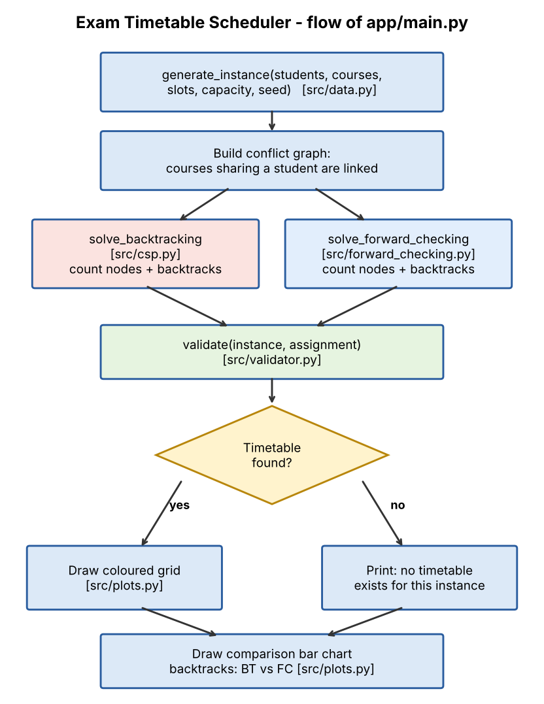

# Exam Timetable Scheduler (AI project)

Builds an exam timetable as a **constraint satisfaction problem (CSP)** and solves it two
ways: plain **backtracking** and **backtracking with forward checking**. The demo shows a
coloured timetable and a chart of how many backtracks each method needed.

## The problem

Every course has one exam. Each exam must get a time slot so that

1. no student has two exams in the same slot, and
2. the total number of students writing in one slot does not exceed the seating capacity.

| CSP term | In this project |
|---|---|
| Variables | each exam (one per course) |
| Domain | the list of slots (Day1-Morning, Day1-Evening, Day2-Morning, ...) |
| Constraint 1 | two courses that share a student cannot use the same slot |
| Constraint 2 | students in one slot <= slot capacity |

## Flowchart



## How to run

Needs Python 3.8+ and matplotlib (`pip install -r requirements.txt`).
Run every command from the repo root.

```bash
python app/main.py                  # full demo: solve twice, grid, comparison chart
python app/main.py --no-show        # same, only saves pictures to output/
python app/main.py --seed 6         # another random class (options: --students --courses --slots --capacity)
python tests/test_data.py           # basic tests (also: pytest tests)
python tests/test_solvers.py
python tests/test_validator.py
```

Default demo (seed 1): backtracking needs 430 backtracks, forward checking 148, and both
return the same valid timetable. Some seeds are much harder (seed 3 takes plain
backtracking far longer) because the search tree grows exponentially.

## Counters

- **nodes**: how many times an exam was given a slot.
- **backtracks**: how many times such a choice was undone because it led to a dead end.

Both solvers use the same course order, the same slot order and the same counters, so the
numbers can be compared fairly.

## Link to graph colouring

Think of each course as a vertex and join two vertices when the courses share a student
(the conflict graph). Each slot is a colour. A valid timetable is a colouring in which
joined vertices never share a colour, which is exactly the graph colouring problem.
Constraint 2 (slot capacity) is an extra limit on how many students one colour may hold.
If the graph needs more colours than there are slots, the instance is unsolvable.

## What each file does

| File | Task | Purpose |
|---|---|---|
| `src/data.py` | EX1 | `Instance`, `generate_instance()` with a seed, conflict graph |
| `src/csp.py` | EX2 | `solve_backtracking()` |
| `src/forward_checking.py` | EX3 | `solve_forward_checking()` |
| `src/validator.py` | EX4 | `validate()` checks both constraints |
| `tests/` | EX4 | tests for the generator, both solvers and the validator |
| `src/plots.py` | EX5 | coloured timetable grid and comparison bar chart |
| `app/main.py` | EX5 | runs the whole demo |
| `docs/flowchart.png` | EX6 | flowchart of the demo |
| `docs/viva.md` | EX6 | ten likely viva questions with answers |

## Features covered (E1 to E7)

E1 data and generator, E2 conflict graph, E3 backtracking solver, E4 forward checking
solver, E5 validator, E6 coloured timetable grid, E7 comparison chart.
